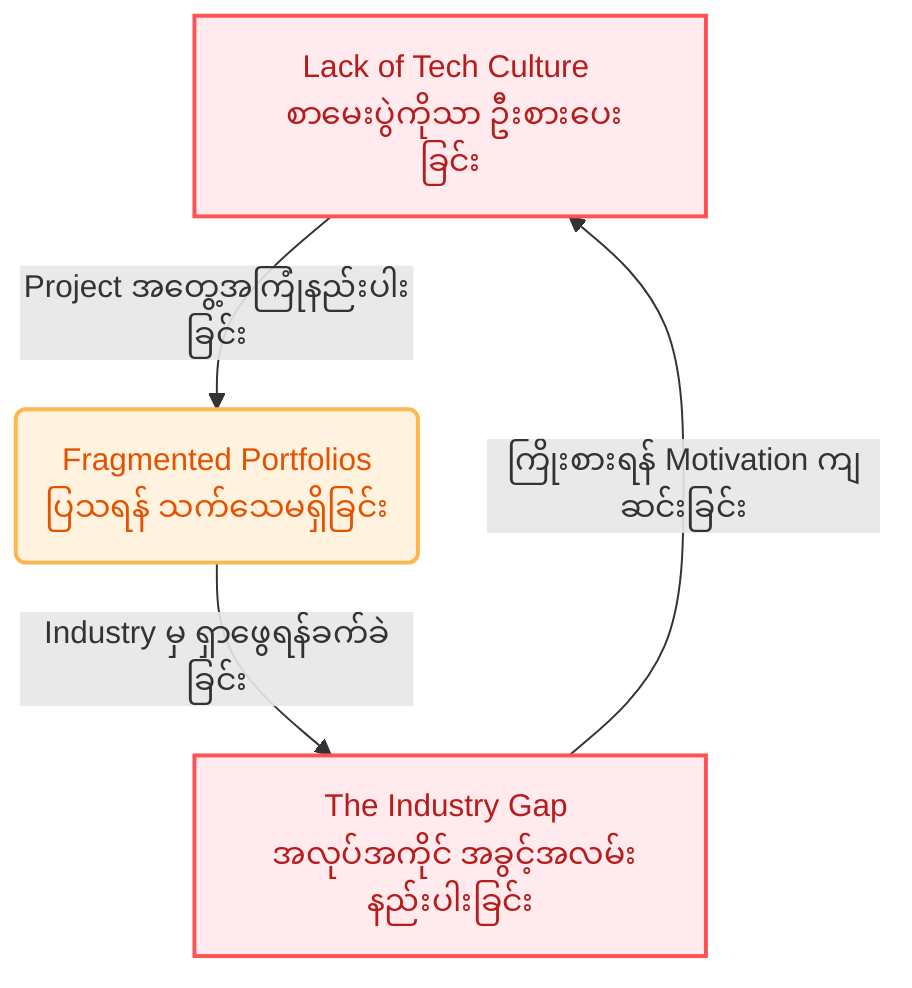
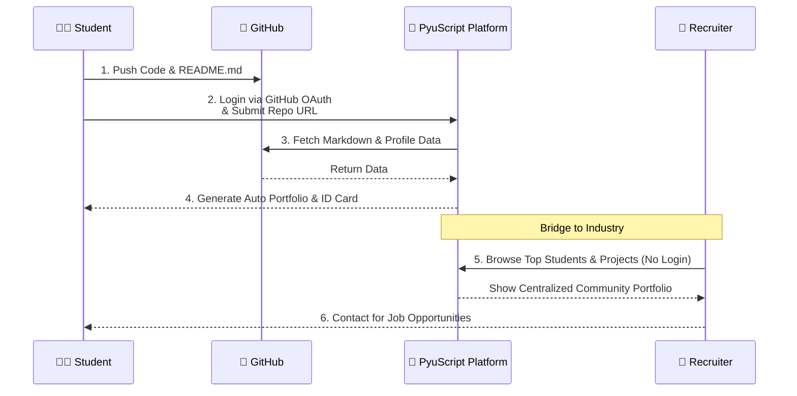
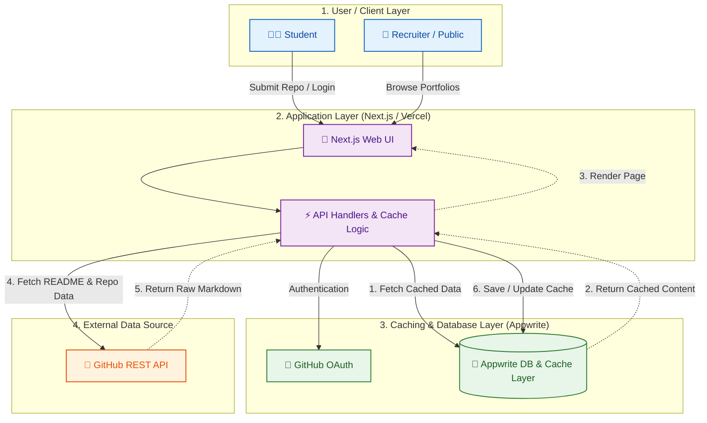

**Final Year Project Proposal**

**Project Title:** PyuScript

**နိဒါန်း (Introduction & The Vision)**
မြန်မာနိုင်ငံ၊ ပြည်မြို့သည် တစ်ချိန်က ပျူလူမျိုးတို့ ထွန်းကားခဲ့ရာ သရေခေတ္တရာဒေသဖြစ်ပြီး ထိုခေတ်အခါက ပညာရေး၊ ဘာသာတရား၊ စီးပွားရေးနှင့် ယဉ်ကျေးမှု အမွေအနှစ်များကို "ကျောက်စာ" များပေါ်တွင် ခိုင်ခိုင်မာမာ မှတ်တမ်းတင် ချန်ထားရစ်ခဲ့ကြပါသည်။ ခေတ်စနစ်များ ပြောင်းလဲလာသည်နှင့်အမျှ ယနေ့ခေတ် University of Computer Studies, Pyay (UCSPYAY) မှ နည်းပညာကျောင်းသား လူငယ်များအတွက်မူ ၎င်းတို့၏ ဆန်းသစ်သော အတွေးအခေါ်များ၊ ရေးသားထားသော Code များနှင့် Research Project များကို ခေတ်သစ် Digital ကျောက်စာချပ်များဖြစ်သည့် "GitHub" ပေါ်တွင် မှတ်တမ်းတင်ကြတော့မည် ဖြစ်ပါသည်။ ထိုသို့ UCSPYAY ကျောင်းသားများ၏ နည်းပညာဆိုင်ရာ အမွေအနှစ်များကို စုစည်းဖော်ပြပေးမည့် Digital ဂေဟစနစ်တစ်ခုကို ဖန်တီးရန် ရည်ရွယ်၍ Programmer များ၏ အရေးအသားဖြစ်သော camelCase ကိုအသုံးပြုကာ **"PyuScript"** ဟု အမည်ပေးထားခြင်း ဖြစ်ပါသည်။

---

**အပိုင်း (၁)။ စီမံကိန်း ဖန်တီးရန် တွန်းအားဖြစ်စေသော လက်ရှိပြဿနာများ (Problem Statement)**

UCSPYAY အပါအဝင် နယ်တက္ကသိုလ် (Regional Universities) များတွင် လက်တွေ့ကြုံတွေ့နေရသော အဓိက အားနည်းချက် (၃) ရပ်ကို ဖြေရှင်းနိုင်ရန် ဤစီမံကိန်းကို စတင်အကောင်အထည်ဖော်ရန် ဆုံးဖြတ်ခဲ့ခြင်း ဖြစ်ပါသည်။

- **နည်းပညာ ယဉ်ကျေးမှုနှင့် လက်တွေ့အသုံးချမှု အားနည်းခြင်း (Lack of Tech & Project Culture):**
  ကျောင်းသားအများစုသည် စာမေးပွဲနီးမှသာ အလွတ်ကျက်မှတ် ဖြေဆိုသည့်စနစ်တွင် ကျင့်သားရနေပြီး၊ လက်တွေ့ Project များ ဖန်တီးခြင်း၊ နည်းပညာအသစ်များ အချင်းချင်း ဖလှယ်ခြင်း (Knowledge Sharing) ပြုလုပ်သည့် ယဉ်ကျေးမှု လွန်စွာအားနည်းနေပါသည်။ စာတွေ့မှသည် လက်တွေ့ Coding လုပ်ဆောင်သည့် ပတ်ဝန်းကျင်တစ်ခု ဖန်တီးပေးမည့် တွန်းအားပေးစနစ် မရှိသေးပါ။
- **လုပ်ငန်းခွင်နှင့် အလှမ်းဝေးကွာခြင်း (The Industry Gap):**
  နယ်တက္ကသိုလ် ဖြစ်သည့်အတွက် ရန်ကုန်၊ မန္တလေးကဲ့သို့သော မြို့ကြီးများရှိ Tech Company များနှင့် တိုက်ရိုက်ထိတွေ့ခွင့်၊ အလုပ်အကိုင် ခေါ်ယူမှုများ (Job Fairs) နည်းပါးလှပါသည်။ ကျောင်းသားများဘက်တွင် အရည်အချင်းရှိသော်လည်း ၎င်းတို့၏ Project များကို ပြင်ပ Recruiter များ၊ ကုမ္ပဏီများမှ လွယ်ကူစွာ ဝင်ရောက်လေ့လာ အကဲဖြတ်နိုင်မည့် "တံတား (Bridge)" တစ်စင်း မရှိသေးသည့်အတွက် အလုပ်အကိုင် အခွင့်အလမ်းများစွာ ဆုံးရှုံးနေရပါသည်။
- **စုစည်းမှုမရှိသော Portfolio များ (Fragmented Portfolios):**
  ကျောင်းသားအချို့သည် Project များ ရေးသားကြသော်လည်း ၎င်းတို့၏ စက်ထဲတွင်သာ ပျောက်ပျက်သွားလေ့ရှိပြီး စနစ်တကျ မှတ်တမ်းတင်ထားခြင်း မရှိပါ။ တစ်ကျောင်းလုံးစာ လွှမ်းခြုံနိုင်ပြီး ကျောင်းသားတစ်ဦးချင်းစီ၏ အရည်အချင်း (Community Portfolio) ကို ပီပြင်စွာ ပြသနိုင်မည့် Centralized Platform မရှိခြင်းသည် ကျောင်း၏ ဖွံ့ဖြိုးတိုးတက်မှုကိုပါ နှောင့်နှေးစေပါသည်။

### Graph Image for Problem Statement

---

**အပိုင်း (၂)။ ပြဿနာများကို ဖြေရှင်းပေးမည့် နည်းလမ်းနှင့် အဓိက လုပ်ဆောင်ချက်များ (Proposed Solution & Core Features)**

**PyuScript** သည် အထက်ပါ ပြဿနာများကို ဖြေရှင်းရန်အတွက် ရိုးရှင်းပြီး ထိရောက်သော **GitHub-Driven Community Platform** တစ်ခုအဖြစ် လုပ်ဆောင်မည်ဖြစ်ပါသည်။ ကျောင်းသားများဘက်မှ Data သီးသန့် Upload တင်နေစရာ မလိုဘဲ၊ မိမိတို့၏ GitHub Repository Link ကို မျှဝေလိုက်ရုံဖြင့် အလိုအလျောက် သပ်ရပ်သော Blog/Project Post တစ်ခုအဖြစ် ပြောင်းလဲပေးမည့် စနစ်ဖြစ်ပါသည်။

အဓိက ပါဝင်မည့် လုပ်ဆောင်ချက်များ (Core Features) မှာ အောက်ပါအတိုင်း ဖြစ်ပါသည် -

1. **GitHub-Driven Content Publishing Engine:**

- ကျောင်းသားများသည် မိမိတို့၏ GitHub Repository တွင် ရေးသားထားသော `README.md` သို့မဟုတ် Markdown ဖိုင်များကို Platform ပေါ်သို့ Link ပေးရုံဖြင့် စနစ်မှ လှပဆွဲဆောင်မှုရှိသော Article / Project Showcase အဖြစ် ပြောင်းလဲ Render လုပ်ပေးမည်ဖြစ်ပါသည်။

2. **Centralized Student Community Portfolio:**

- GitHub OAuth ဖြင့် Sign In ဝင်ရောက်သည်နှင့် ကျောင်းသားတစ်ဦးချင်းစီ၏ GitHub Profile အချက်အလက်များ၊ ရေးသားထားသော Project များကို စုစည်းပေးထားသည့် **Community Portfolio Page** (ဥပမာ - `pyuscript/profile/student_name`) အဖြစ် အလိုအလျောက် ဖန်တီးပေးမည်ဖြစ်ပါသည်။

3. **Recruiter Talent Explorer (Industry Bridge):**

- ပြင်ပ ကုမ္ပဏီများနှင့် Recruiter များအနေဖြင့် Account ဖွင့်စရာမလိုဘဲ UCSPYAY ကျောင်းသားများ၏ နည်းပညာအလိုက် ရေးသားထားသော Project များ၊ Top Contributors များနှင့် အရည်အချင်းများကို လွယ်ကူစွာ ဝင်ရောက်ကြည့်ရှု စိစစ်နိုင်မည်ဖြစ်ပါသည်။

4. **Physical Smart Identity Card (QR Code Integration):**

- ကျောင်းသားတစ်ဦး၏ Digital Portfolio Link ကို QR Code အဖြစ် ပြောင်းလဲပေးပြီး၊ ပြင်ပတွင် ကိုင်ဆောင်နိုင်သည့် Physical Smart Identity Card (PDF/Image format) အဖြစ် အလိုအလျောက် Generate ထုတ်ပေးမည့် Local Feature ပါဝင်ပါမည်။

5. **Community Interaction & Engagement:**

- ကျောင်းသားများအချင်းချင်း Project များကို Bookmark/Save လုပ်ထားနိုင်ခြင်း၊ Tags (ဥပမာ - #React, #AI, #C++) များဖြင့် ရှာဖွေနိုင်ခြင်းနှင့် တုံ့ပြန်ဆွေးနွေးနိုင်မည့် Knowledge Sharing Feature များ ပါဝင်ပါမည်။

### ၂.၂. PyuScript ၏ အလုပ်လုပ်ပုံ အဆင့်ဆင့် (System Workflow)

---

### ၃.၃။ GitHub API Rate Limit Optimization Strategy

GitHub API ၏ သာမန် ခေါ်ယူခွင့် ကန့်သတ်ချက် (Rate Limit: 60 requests/hr) ကို ကျော်လွှားနိုင်ရန်အတွက် **Appwrite DB ကို Caching Layer အဖြစ် သုံးစွဲမည့် Architecture** ကို ရေးဆွဲထားပါသည် -

1. **Submission Time Caching:** ကျောင်းသားမှ Link စတင်ထည့်သွင်းချိန် သို့မဟုတ် မွမ်းမံချိန် (Update Time) တွင်မှသာ GitHub API ကို တစ်ကြိမ် လှမ်းခေါ်ပြီး ရလာသော Markdown များနှင့် အချက်အလက်များကို Appwrite DB တွင် Cache သိမ်းဆည်းပါမည်။
2. **Serving from Cache:** အခြား User များနှင့် Recruiter များ ဝင်ရောက် ကြည့်ရှုသည့်အခါ GitHub API သို့ တိုက်ရိုက် မသွားတော့ဘဲ Appwrite DB ထဲရှိ Cache Data မှသာ တန်းထုတ်ပြမည်ဖြစ်၍ GitHub Rate Limit ငြိမည့် ပြဿနာကို ရာခိုင်နှုန်းပြည့် ဖြေရှင်းထားပါသည်။
3. **On-Demand & Webhook Syncing:** အချက်အလက်များ လတ်ဆတ်နေစေရန် (Freshness) အတွက် ကျောင်းသားမှ "Sync" Button ကို Cooldown သတ်မှတ်ချက်ဖြင့် နှိပ်နိုင်ခြင်း သို့မဟုတ် GitHub Webhook ဖြင့် Automatic Syncing လုပ်ဆောင်နိုင်မည့် စနစ် ပါဝင်မည်ဖြစ်ပါသည်။

---

**အပိုင်း (၄)။ လက်တွေ့ လည်ပတ်နိုင်မှု၊ ကုန်ကျစရိတ်နှင့် ရေရှည် ထိန်းသိမ်းနိုင်မှု (Operational & Financial Feasibility)**

**PyuScript** စနစ်သည် သီအိုရီမျှသာ မဟုတ်ဘဲ ပြင်ပတွင် တကယ်တမ်း လက်တွေ့ လည်ပတ်နိုင်ရန်အတွက် Operational နှင့် Financial Feasibility များကို အောက်ပါအတိုင်း သေချာတွက်ချက် ပုံဖော်ထားပါသည် -

1. **Zero-Cost Infrastructure Setup:**

- **Frontend Hosting:** Next.js Application ကို Vercel (Free Tier) ပေါ်တွင် Host လုပ်မည်ဖြစ်ရာ Hosting ကုန်ကျစရိတ် လုံးဝ မရှိပါ။
- **Backend/Database:** Appwrite Cloud (Free Tier) သို့မဟုတ် ကျောင်းရှိ Local Server/Self-hosted Environment တွင် Run ထားနိုင်သည့်အတွက် Database Cost လည်း မရှိသလောက် သက်သာမည် ဖြစ်ပါသည်။
- **Storage Cost:** Document ၊ Media များနှင့် Project Data များကို GitHub ၏ Free Cloud Infrastructure ပေါ်တွင်သာ မှီခိုထားသည့်အတွက် File Storage Cost လုံးဝ (၀) ဖြစ်ပါသည်။

2. **Low Maintenance Architecture:**

- User တိုင်း၏ Data များကို GitHub ပေါ်တွင်သာ ထိန်းသိမ်းထားသည့်အတွက် Database Maintenance လုပ်ရသည့် ဝန်ထုတ်ဝန်ပိုး နည်းပါးပါသည်။
- System Maintenance အတွက် ကျောင်း၏ IT Community (404 Sleep Not Found / Technology Canteen) မှ Admin/Student Leads များက အလွယ်တကူ ဆက်လက် ထိန်းသိမ်းသွားနိုင်မည့် စနစ်ဖြစ်ပါသည်။

---

**အပိုင်း (၅)။ အသိုင်းအဝိုင်းနှင့် ကျောင်းအတွက် ရရှိလာမည့် အကျိုးကျေးဇူးများ (Community & Academic Impact)**

**PyuScript** ကို အကောင်အထည်ဖော်ခြင်းဖြင့် UCSPYAY Campus နှင့် အပြင်ပတ်ဝန်းကျင်အတွက် အောက်ပါ ကောင်းကျိုးများ ရရှိလာမည်ဖြစ်ပါသည် -

- **ကျောင်းသားများအတွက် (For Students):**
- စာမေးပွဲနီးမှ အလွတ်ကျက်သည့် အလေ့အထမှ **Project-based Learning Mindset** သို့ ကူးပြောင်းသွားစေမည်။
- မိမိရေးထားသော Project များကို စနစ်တကျ Document လုပ်ပြီး ပြင်ပသို့ ပြသနိုင်သည့် **Professional Portfolio** တစ်ခု အလိုအလျောက် ရရှိသွားမည်။
- ကျောင်းသားအချင်းချင်း Project များကို ကြည့်ရှုလေ့လာပြီး နည်းပညာ ဖလှယ်သည့် ယဉ်ကျေးမှု (Knowledge Sharing Culture) စတင်လာမည်။

- **ပြင်ပ အလုပ်အကိုင် အခွင့်အလမ်းများအတွက် (For Industry Bridge):**
- ရန်ကုန်၊ မန္တလေးနှင့် အခြား မြို့ကြီးများရှိ Tech Company များနှင့် Recruiter များအနေဖြင့် နယ်ကျောင်းဖြစ်သော UCSPYAY မှ အရည်အချင်းရှိ ကျောင်းသားများကို တစ်နေရာတည်းတွင် အလွယ်တကူ ရှာဖွေခန့်ထားနိုင်မည်။

- **ကျောင်းအတွက် (For UCSPYAY Institution):**
- UCSPYAY ၏ နည်းပညာအဆင့်အတန်းနှင့် ကျောင်းသားများ၏ လက်တွေ့ စွမ်းဆောင်ရည်ကို ပြင်ပသို့ ပီပြင်စွာ ထုတ်ပြနိုင်မည့် **Digital Showcase** တစ်ခု ဖြစ်လာမည်။
- ကျောင်း၏ ဂုဏ်သတင်းနှင့် ကျောင်းဆင်းများ၏ အလုပ်အကိုင် ရရှိမှုနှုန်း (Employability Rate) ကို တိုးတက်စေမည်။

---

**အပိုင်း (၆)။ နိဂုံး (Conclusion)**

**PyuScript** သည် UCSPYAY ကျောင်းသားများ၏ Project များနှင့် နည်းပညာဆိုင်ရာ လေ့လာဆန်းသစ်မှုများကို စနစ်တကျ စုစည်းပြသပေးနိုင်မည့် Community Portfolio & Knowledge Platform တစ်ခု ဖြစ်ပါသည်။

ရှေးယခင် သရေခေတ္တရာခေတ်၏ မှတ်တမ်းတင်လေ့ရှိသော ယဉ်ကျေးမှုဆိုင်ရာ အမြစ်တွယ်မှုကို အခြေခံ၍ ယနေ့ခေတ် Digital စနစ် (GitHub) ဖြင့် ပေါင်းစပ်ထားသော ဤ Platform သည် ကျောင်းသားများအချင်းချင်း နည်းပညာ ဖလှယ်ရေး၊ လက်တွေ့ Project များ ပိုမိုလုပ်ဆောင်ရေးနှင့် ပြင်ပ အလုပ်အကိုင် အခွင့်အလမ်းများနှင့် ပိုမို နီးစပ်လာရေးတို့အတွက် အထောက်အကူပြုနိုင်မည် ဖြစ်ပါသည်။

ထို့ကြောင့် PyuScript သည် UCSPYAY တွင် Project-based Learning Culture နှင့် Digital Portfolio Ecosystem တစ်ခု စတင်နိုင်ရန် အကောင်အထည်ဖော်သင့်သည့် Final Year Project တစ်ခုအဖြစ် တင်ပြအပ်ပါသည်။
